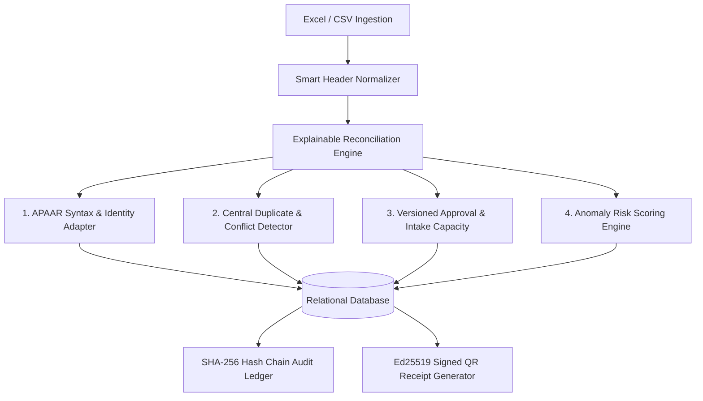

# PRAMAAN-AICTE
### Platform for Real-time APAAR-linked Monitoring, Auditing, and Academic Network
**Smart India Hackathon 2026 | Problem Statement SIH26263**

> *"Development of an APAAR ID-Based Student Data Management and Verification Platform for AICTE-Approved Institutions."*

---

## 1. System Vision & Regulatory Architecture

**PRAMAAN-AICTE** is a regulatory data management and intelligence platform built to resolve nationwide student data fragmentation across technical education institutions. It connects institutional data submissions directly with:

1. **APAAR 12-Digit Academic Identity Verification**: Deterministic validation and integration contract with ABC / MeriPehchaan.
2. **Versioned AICTE Approval Capacity Rules**: Real-time intake ceilings, quota isolation (TFW, EWS, Management), and supernumerary seat monitoring.
3. **Cross-Institution Duplicate Reconciliation**: Automated detection and case adjudication for concurrent active technical admissions across different colleges.
4. **Explainable Regulatory Anomaly Detection**: Transparent statistical scoring on intake surges, deadline clustering, and quota skews.
5. **Cryptographic Trust Layer**: Ed25519 asymmetric signed verification receipts with QR codes (zero student PII in public URLs) and a tamper-evident SHA-256 hash-chain audit ledger.



---

## 2. Technology Stack

- **Frontend**: Next.js 14 (App Router), TypeScript (Strict), Tailwind CSS (Government-Tech Design Tokens), Lucide Icons, Recharts.
- **Backend**: Python 3.10+, FastAPI (Modular Monolith), Pydantic v2, SQLAlchemy 2, SQLite (zero-setup default with WAL mode) / PostgreSQL pluggable.
- **Security & Cryptography**: Ed25519 (Curve25519) digital signatures, HMAC-SHA256 keyed APAAR indexing, bcrypt password hashing.
- **Testing**: Pytest automated suite covering all 6 functional acceptance gates + Antigravity Browser Agent end-to-end verification.

---

## 3. Evaluator Quick Credentials

The platform features a **Role Switcher** in the top bar for instant persona demonstration:

| Role | Email | Password | Scope & Responsibilities |
| :--- | :--- | :--- | :--- |
| **AICTE Central Admin** | `aicte.admin@pramaan.gov.in` | `Admin@12345` | Nationwide intake compliance, conflict adjudication, anomaly audit. |
| **Regional Officer (WRO)** | `ro.mumbai@aicte.gov.in` | `Officer@12345` | Regional oversight and hearing escalations. |
| **DTU Delhi (Nodal Officer)** | `nodal.dtu@dtu.ac.in` | `College@12345` | Institutional data ingestion, pre-flight review, college admissions. |
| **COEP Pune (Nodal Officer)** | `nodal.coep@coep.ac.in` | `College@12345` | Institutional upload batch history and conflict responses. |
| **Authorized Verifier** | `verifier.corp@tcs.com` | `Verify@12345` | Employer public verification and QR receipt scanning. |

---

## 4. Local Setup & Execution Guide (Windows PowerShell)

### Step 1: Clone & Inspect Workspace
```powershell
cd d:\AICTE
```

### Step 2: Backend Virtual Environment & Dependencies
```powershell
# Create venv and install dependencies
py -3.10 -m venv backend\venv
.\backend\venv\Scripts\pip install -r backend\requirements.txt
```

### Step 3: Seed Synthetic Demonstration Data
Populates colleges (DTU, COEP, RVCE, Jadavpur), approved intakes, test duplicate conflicts, and initial hash chain:
```powershell
.\backend\venv\Scripts\python .\backend\scripts\seed_data.py
```

### Step 4: Run Automated Acceptance Tests (All 6 Gates)
```powershell
.\backend\venv\Scripts\pytest .\backend\tests\test_all_gates.py -o pythonpath=backend -v
```

### Step 5: Launch Services

**Terminal 1 — Backend Server:**
```powershell
.\backend\venv\Scripts\python -m uvicorn app.main:app --host 127.0.0.1 --port 8000 --app-dir backend
```
*API Documentation available at: [http://localhost:8000/docs](http://localhost:8000/docs)*

**Terminal 2 — Frontend Application:**
```powershell
cd d:\AICTE\frontend
npm install
npm run dev
# OR for production build:
# npm run build; npm run start
```
*Platform UI accessible at: [http://localhost:3000](http://localhost:3000)*

---

## 5. Verified Demonstration Workflows

1. **Intake Compliance Dashboard (`/dashboard`)**:
   - Sanctioned capacity vs. verified enrolment bar charts.
   - Affirmative action / category distribution breakdown.
   - Priority dispute queue and live audit stream.
2. **Smart Pre-flight Uploader (`/uploads`)**:
   - Automatic column header alias normalizer (`apaar_id`, `student_name`, `dob`, `programme_code`).
   - Row-level findings with severities (`ERROR`, `WARNING`, `INFO`).
3. **Cross-Institution Duplicate Adjudication (`/conflicts`)**:
   - Case **`CONF-2026-0042`**: Student simultaneously claimed by COEP Pune and DTU Delhi.
   - Side-by-side claim comparison with one-click resolution.
4. **Explainable Anomaly Inspection (`/anomalies`)**:
   - Case **`ANOM-2026-0019`**: 89% intake surge near deadline flagged at RVCE.
5. **Ed25519 Signed Verification Receipts (`/verification`)**:
   - Issue receipt & generate QR code for any enrolled student.
   - Standalone public verification portal: `/verification/receipt/[token]` (zero student PII in URL).
6. **Tamper-Evident SHA-256 Audit Ledger (`/audit`)**:
   - Click **Verify Hash Chain Integrity** to cryptographically validate the unbroken hash link across all sequential events.

---

## 6. Truthful Implementation Disclosures

- **Identity Gateway**: Features a deterministic `MockApaarAdapter` explicitly simulating verified status, demographic mismatch, record-not-found, and gateway timeout. Real student data is never transmitted to unverified third parties during hackathon evaluation.
- **Tamper-Evident Hash Chain**: Each event is cryptographically hashed with its preceding event (`current_hash = SHA256(... + prev_hash)`). In this prototype, the ledger is stored in the relational database. In production, an external append-only log or Hardware Security Module (HSM) would be used for distributed immutability.
- **AI / Anomaly Engine**: Operates purely on transparent, explainable business heuristics and statistical deviation signals without unverifiable claims of black-box ML fraud detection.
