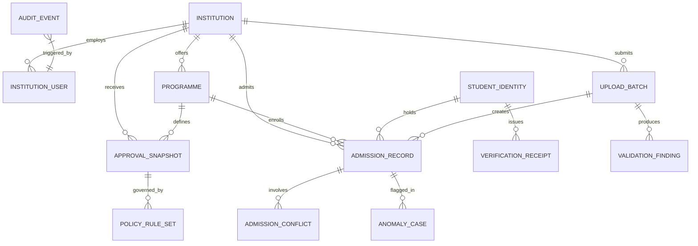

# Data Model & Relational Architecture: PRAMAAN-AICTE

## 1. Design Principles

1. **Immutable Internal Keys**: Every entity uses an internal UUID (or synthetic sequential primary key) as primary identifier. APAAR numbers are **never** used as foreign key references across tables.
2. **Identity vs. Admission Separation**: A `StudentIdentity` represents an individual student's verified academic identity anchor, while `AdmissionRecord` captures the specific enrolment event (institution, programme, quota, academic year, status). This enables clean handling of transfers, dual legitimate programmes (where permitted), and historical transitions.
3. **Privacy & Data Minimization**:
   - `apaar_hash`: Keyed HMAC-SHA256 digest of the 12-digit APAAR ID used for deterministic exact-match indexing.
   - `apaar_masked`: Masked display format (`XXXXXXXX1234`) for authorized administrative views.
   - Zero raw APAAR IDs in logs, URLs, or external audit payloads.
4. **Audit Immutability**: Every row in `audit_events` references the previous event's cryptographic hash, forming an unbroken verifiable SHA-256 chain.

---

## 2. Entity Relational Schema

---

## 3. Core Tables Specification

### 3.1 `institutions`
- `id` (UUID / INT, PK)
- `aicte_id` (VARCHAR(32), UNIQUE, e.g. "1-1049281")
- `name` (VARCHAR(255))
- `state` (VARCHAR(64))
- `district` (VARCHAR(64))
- `institution_type` (VARCHAR(64), e.g. "CENTRAL_UNIVERSITY", "STATE_GOVT_AIDED", "PRIVATE_UNAIDED")
- `status` (VARCHAR(32), e.g. "APPROVED", "SUSPENDED", "PROBATION")
- `created_at` (TIMESTAMP)

### 3.2 `institution_users`
- `id` (UUID / INT, PK)
- `institution_id` (FK -> institutions.id, NULLABLE for central AICTE officers)
- `email` (VARCHAR(255), UNIQUE)
- `hashed_password` (VARCHAR(255))
- `full_name` (VARCHAR(128))
- `role` (VARCHAR(32), "AICTE_ADMIN", "REGIONAL_OFFICER", "INSTITUTION_NODAL", "VERIFIER")
- `is_active` (BOOLEAN)
- `created_at` (TIMESTAMP)

### 3.3 `programmes`
- `id` (UUID / INT, PK)
- `institution_id` (FK -> institutions.id)
- `programme_code` (VARCHAR(32), e.g. "BTECH-CSE", "BTECH-ECE", "MCA", "MBA")
- `programme_name` (VARCHAR(128))
- `degree_level` (VARCHAR(32), "UG", "PG", "DIPLOMA")
- `duration_years` (INT)
- `created_at` (TIMESTAMP)

### 3.4 `approval_snapshots`
- `id` (UUID / INT, PK)
- `institution_id` (FK -> institutions.id)
- `programme_id` (FK -> programmes.id)
- `academic_year` (VARCHAR(16), e.g. "2024-25", "2025-26", "2026-27")
- `approved_intake` (INT)
- `supernumerary_quota` (JSONB / TEXT, e.g. `{"TFW": 5, "EWS": 10, "JK_MIGRANT": 2}`)
- `approval_letter_ref` (VARCHAR(128), e.g. "AICTE/NWRO/2026/1-987654")
- `version` (INT, default 1)
- `is_active` (BOOLEAN)
- `created_at` (TIMESTAMP)

### 3.5 `student_identities`
- `id` (UUID / INT, PK)
- `apaar_hash` (VARCHAR(64), UNIQUE, INDEXED) -- HMAC-SHA256
- `apaar_masked` (VARCHAR(16)) -- "XXXX-XXXX-1234"
- `full_name` (VARCHAR(128))
- `dob` (DATE)
- `gender` (VARCHAR(16))
- `verification_status` (VARCHAR(32), "VERIFIED", "UNVERIFIED", "MISMATCH", "REJECTED")
- `provider_reference` (VARCHAR(128))
- `verified_at` (TIMESTAMP, NULLABLE)
- `created_at` (TIMESTAMP)

### 3.6 `admission_records`
- `id` (UUID / INT, PK)
- `student_id` (FK -> student_identities.id)
- `institution_id` (FK -> institutions.id)
- `programme_id` (FK -> programmes.id)
- `batch_id` (FK -> upload_batches.id)
- `academic_year` (VARCHAR(16))
- `enrollment_no` (VARCHAR(64))
- `category` (VARCHAR(32), "OPEN", "OBC_NCL", "SC", "ST", "EWS")
- `admission_quota` (VARCHAR(32), "STATE_GOVT", "AICTE_TFW", "MANAGEMENT", "NRI", "PIO")
- `admission_date` (DATE)
- `status` (VARCHAR(32), "STAGED", "ACTIVE", "WITHDRAWN", "TRANSFERRED", "CANCELLED")
- `created_at` (TIMESTAMP)
- `updated_at` (TIMESTAMP)

### 3.7 `upload_batches`
- `id` (UUID / INT, PK)
- `institution_id` (FK -> institutions.id)
- `submitted_by_user_id` (FK -> institution_users.id)
- `filename` (VARCHAR(255))
- `file_hash` (VARCHAR(64)) -- SHA-256 for idempotency
- `academic_year` (VARCHAR(16))
- `total_rows` (INT)
- `valid_rows` (INT)
- `warning_rows` (INT)
- `error_rows` (INT)
- `status` (VARCHAR(32), "UPLOADED", "PREFLIGHT", "COMMITTED", "REJECTED")
- `created_at` (TIMESTAMP)

### 3.8 `validation_findings`
- `id` (UUID / INT, PK)
- `batch_id` (FK -> upload_batches.id)
- `row_index` (INT)
- `field_name` (VARCHAR(64))
- `rule_id` (VARCHAR(64), e.g. "RULE_APAAR_FORMAT", "RULE_CAPACITY_EXCEEDED")
- `severity` (VARCHAR(16), "ERROR", "WARNING", "INFO")
- `message` (TEXT)
- `recommended_action` (TEXT)
- `created_at` (TIMESTAMP)

### 3.9 `admission_conflicts`
- `id` (UUID / INT, PK)
- `case_number` (VARCHAR(32), UNIQUE, e.g. "CONF-2026-0042")
- `student_id` (FK -> student_identities.id)
- `record_a_id` (FK -> admission_records.id)
- `record_b_id` (FK -> admission_records.id)
- `conflict_type` (VARCHAR(64), "CROSS_INSTITUTION_DUPLICATE", "WITHIN_BATCH_DUPLICATE", "ILLEGAL_DUAL_DEGREE")
- `status` (VARCHAR(32), "OPEN", "UNDER_INVESTIGATION", "RESOLVED_VALID", "RESOLVED_CANCELLED", "ESCALATED")
- `resolution_notes` (TEXT)
- `resolved_by_user_id` (FK -> institution_users.id, NULLABLE)
- `created_at` (TIMESTAMP)
- `resolved_at` (TIMESTAMP, NULLABLE)

### 3.10 `anomaly_cases`
- `id` (UUID / INT, PK)
- `case_number` (VARCHAR(32), UNIQUE, e.g. "ANOM-2026-0019")
- `institution_id` (FK -> institutions.id)
- `programme_id` (FK -> programmes.id, NULLABLE)
- `academic_year` (VARCHAR(16))
- `risk_score` (FLOAT) -- 0.0 to 100.0
- `anomaly_type` (VARCHAR(64), "INTAKE_SPIKE", "CATEGORY_DISTRIBUTION_ANOMALY", "COLLISION_BURST", "DEADLINE_CLUSTERING")
- `signals_json` (JSONB / TEXT)
- `explanation` (TEXT)
- `status` (VARCHAR(32), "PENDING_REVIEW", "INSPECTED_CLEARED", "ESCALATED_AUDIT")
- `created_at` (TIMESTAMP)

### 3.11 `verification_receipts`
- `id` (UUID / INT, PK)
- `receipt_token` (VARCHAR(64), UNIQUE, INDEXED) -- Opaque secure token
- `student_id` (FK -> student_identities.id)
- `admission_record_id` (FK -> admission_records.id)
- `claim_scope` (VARCHAR(64), "ACTIVE_ENROLMENT_STATUS")
- `ed25519_signature` (TEXT) -- Base64 encoded signature
- `payload_digest` (VARCHAR(64)) -- SHA-256 of canonical signed payload
- `expires_at` (TIMESTAMP)
- `is_revoked` (BOOLEAN, default FALSE)
- `revocation_reason` (TEXT, NULLABLE)
- `created_at` (TIMESTAMP)

### 3.12 `audit_events`
- `id` (UUID / INT, PK)
- `sequence_no` (BIGINT, UNIQUE)
- `actor_id` (FK -> institution_users.id, NULLABLE)
- `actor_role` (VARCHAR(32))
- `action` (VARCHAR(64), e.g. "BATCH_COMMITTED", "CONFLICT_RESOLVED", "RECEIPT_ISSUED", "RECEIPT_REVOKED")
- `entity_type` (VARCHAR(64))
- `entity_id` (VARCHAR(64))
- `metadata_json` (JSONB / TEXT)
- `correlation_id` (VARCHAR(64))
- `previous_hash` (VARCHAR(64))
- `current_hash` (VARCHAR(64)) -- SHA-256(sequence_no + actor_id + action + timestamp + metadata + previous_hash)
- `created_at` (TIMESTAMP)
